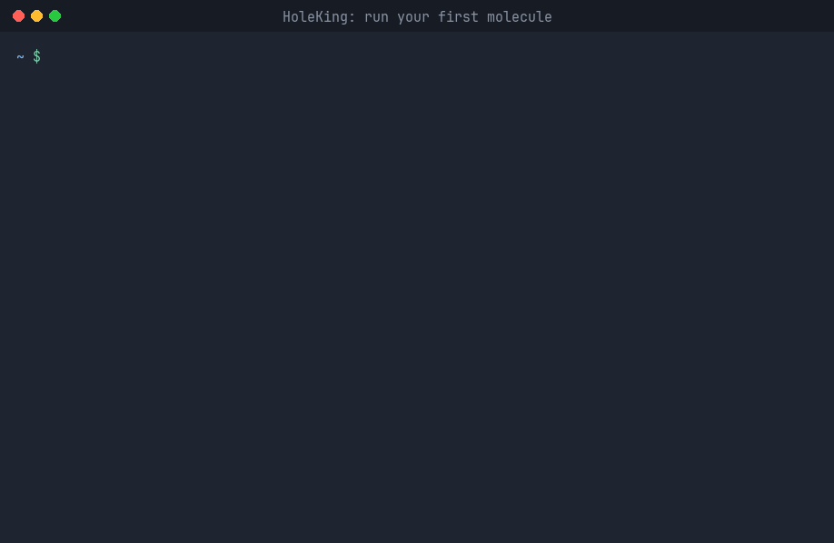

# HoleKing

HoleKing tells you where the hole and the electron go in each excited state of a molecule.
It works with sTDA-xTB and sTD-DFT-xTB, which are fast enough for large dye molecules. Multiwfn
can't read these results, so HoleKing does the hole–electron analysis itself.

For every excited state you get:

- energy, wavelength and oscillator strength;
- the usual hole–electron indices (Sr, D, H, t), same definitions as Multiwfn;
- how much of the hole and of the electron sits on each fragment, and how much charge moves
  from one fragment to another (IFCT).

Everything ends up in one CSV file, one row per state.

## Requirements

- Python 3.9 or newer
- `xtb4stda` and `stda` (or `std2`)
- rdkit, only if you want fragments split around a core automatically

## Tutorial: from zero to your first result

A printable version of this tutorial is in [`docs/how-to-run.pdf`](docs/how-to-run.pdf).
Every command below goes in a Linux terminal.

**1. Get xtb4stda and stda.** HoleKing doesn't compute the excited states itself; these two
programs from the Grimme group do. Download both programs and their parameter files into a
folder called `xtb4stda` in your home:

```bash
cd ~
git clone https://github.com/grimme-lab/xtb4stda.git      # parameter files (.param_*)
cd xtb4stda
wget https://github.com/grimme-lab/xtb4stda/releases/download/v1.0/xtb4stda
wget https://github.com/grimme-lab/xtb4stda/releases/download/v1.0/stda_v1.6.1
chmod +x xtb4stda stda_v1.6.1                              # make them executable
```

If they are already installed on your machine or cluster, skip this step and use their paths
in step 2.

**2. Tell HoleKing where they are.** HoleKing finds the programs through three environment
variables. Adding them to `~/.bashrc` means you only do this once:

```bash
echo 'export XTB4STDA_BIN=~/xtb4stda/xtb4stda' >> ~/.bashrc
echo 'export STDA_BIN=~/xtb4stda/stda_v1.6.1' >> ~/.bashrc
echo 'export XTB4STDAHOME=~/xtb4stda' >> ~/.bashrc
source ~/.bashrc
```

`XTB4STDAHOME` is the folder with the `.param_stda1.xtb`, `.param_stda2.xtb` and
`.param_gbsa_<solvent>` files.

**3. Download HoleKing.**

```bash
cd ~
git clone https://github.com/rafaelfv27/ElectronHoleKing.git
cd ElectronHoleKing
```

**4. Create a Python environment.** This is a private folder for HoleKing's Python packages,
so they don't clash with the rest of your system. Many Linux systems refuse `pip install`
without one.

```bash
python3 -m venv ~/holeking-env
source ~/holeking-env/bin/activate
```

Your prompt now starts with `(holeking-env)`. Every time you open a new terminal, run the
`source` line again before using HoleKing.

**5. Install HoleKing.** Still inside the `ElectronHoleKing` folder:

```bash
pip install .
pip install rdkit
```

The first line installs HoleKing (the `.` means "the program in this folder") together with
numpy and pyscf, which it needs. The second one is optional: rdkit is only used to split the
molecule into fragments around a core (the BTD core option below).

**6. Check that it works.**

```bash
holeking --help
```

You should see the list of commands. If you get `command not found`, the environment from
step 4 is not active: run `source ~/holeking-env/bin/activate`.

**7. Run your first molecule.** The repository comes with a small test molecule,
benzothiadiazole. Copy it to a new folder and run HoleKing there:

```bash
mkdir ~/holeking-test && cd ~/holeking-test
cp ~/ElectronHoleKing/tests/data/btd/geom.xyz btd.xyz
holeking
```

HoleKing asks a few questions. For this test, press Enter on every one to keep the value
in brackets. This is what the whole run looks like (it takes about 2 seconds):



The questions, as text:

```
xyz file(s) [btd.xyz]:
solvent (none, water, toluene, thf, ...) [none]:
method: tda = sTDA-xTB, rpa = sTD-DFT-xTB [tda]:
number of excited states [10]:
molecular charge [0]:
fragments: 1 = BTD core, 2 = other core (SMARTS), 3 = fragment file, 4 = none [1]:
save results to [btd.csv]:
```

For your own molecules, do the same in the folder with your `.xyz`
files. What the questions mean:

- **solvent:** implicit solvent (GBSA) for the ground state, or `none` for gas phase.
- **method:** `tda` (sTDA-xTB) is the fast default; `rpa` (sTD-DFT-xTB) is a bit slower.
- **fragments:** how to split the molecule into donor/acceptor parts. With a BTD core (or any
  core you describe with SMARTS), the core and its hydrogens are fragment 1 and each piece
  attached to it becomes its own fragment. Or write a fragment file the Multiwfn way: one
  fragment per line, atom numbers starting at 1, ranges allowed (`1,3,6-10`).

If you type something it can't use, it tells you why and asks again. Ctrl+C quits.

**8. Look at the results.** HoleKing makes a folder `btd_holeking/` with the xtb and stda
files and logs, and writes `btd.csv`, one row per excited state:

```
state,energy_ev,wavelength_nm,f,first_bright,near_degenerate_bright,sr,d_index,...
1,4.6349,267.501,0.265347,1,1,0.910232,0.0509087,...
```

| column | meaning |
|---|---|
| `energy_ev`, `wavelength_nm`, `f` | excitation energy, wavelength, oscillator strength |
| `first_bright` | 1 for the lowest state with real intensity |
| `sr` | hole–electron overlap: near 1 is a local excitation, near 0 is charge transfer |
| `d_index` | distance between hole and electron centres (Å) |
| `t_index` | positive means hole and electron are well separated |
| `hole_fragN_*`, `ele_fragN_*` | fraction of the hole / electron on fragment N |
| `ct_intrinsic_*` | fraction of the excitation that is real charge transfer |

**9. Next time, skip the questions.** At the end HoleKing prints the same job as a one-line
command. Use it in scripts or on a cluster:

```bash
holeking run dad.xyz --solvent h2o --core btd --csv dad.csv
holeking run *.xyz --jobs 8 --core btd --csv all.csv       # 8 molecules at a time
holeking analyze dad_holeking/ --fragments frags.txt       # redo the analysis only
holeking run --help                                         # every option
```

The results were checked against Multiwfn (Sr within 0.001, D within 0.03 Å) and the oscillator
strengths are recomputed and compared with `stda` for every state. See `tests/`.

## References

- T. Lu, F. Chen, *J. Comput. Chem.* **33**, 580 (2012). Multiwfn.
- S. Grimme, C. Bannwarth, *J. Chem. Phys.* **145**, 054103 (2016). sTDA-xTB.
- std2: https://github.com/Theoretical-Chemistry-Group-UCLouvain/std2
- Q. Sun et al., *J. Chem. Phys.* **153**, 024109 (2020). PySCF.

MIT license.
